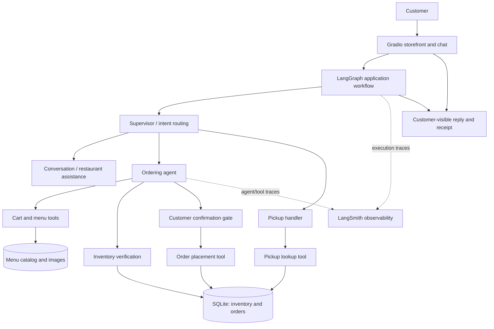
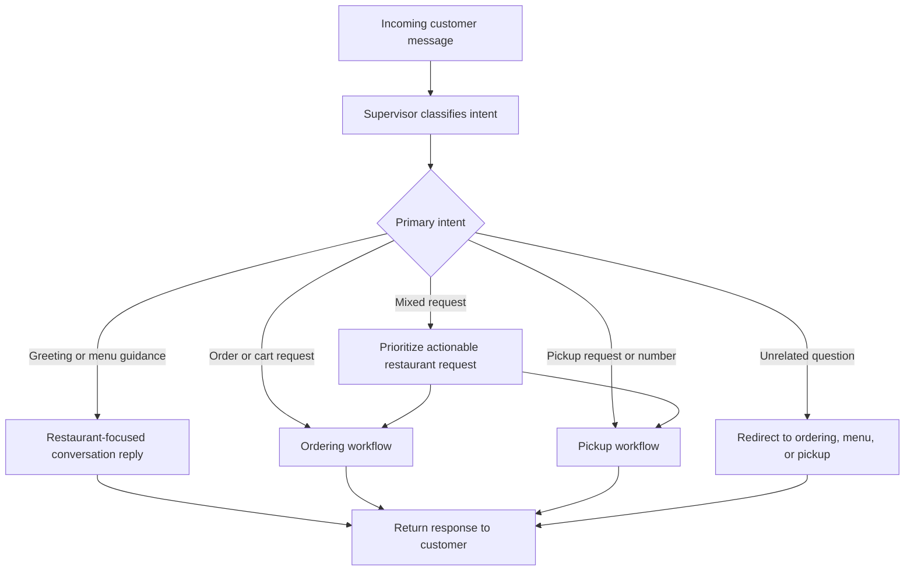
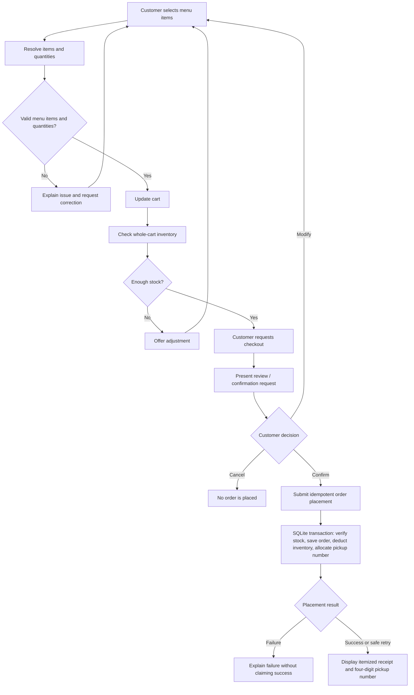
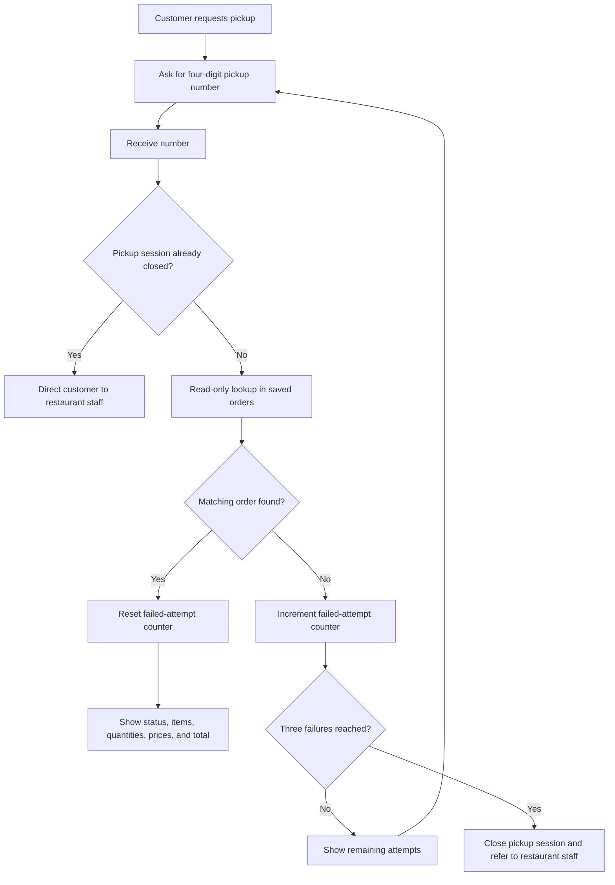
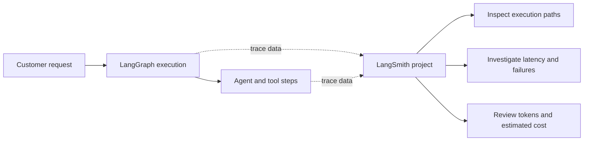

# AI Restaurant Assistant

**An AI-powered restaurant ordering and pickup experience built with a stateful, multi-agent workflow.**

The AI Restaurant Assistant is an engineering portfolio project that explores how conversational AI can be integrated into a practical restaurant workflow: browsing a menu, managing a cart, verifying inventory, placing an order with explicit customer confirmation, and retrieving an existing order using a four-digit pickup number.

The application combines **LangGraph orchestration**, **LangChain-based agent/tool integration**, a **Gradio storefront**, **SQLite persistence**, and **LangSmith observability**. The full implementation is maintained separately in a private source-code repository; this public repository documents the design, behavior, and engineering decisions.

> **Project status:** Working local prototype. The application has passed **107 automated tests** and has been exercised through the Gradio interface. This is a portfolio demonstration, not a claim of production deployment.

## At a glance

| Area | Capability |
| --- | --- |
| Customer experience | Conversational ordering alongside a visual, eight-item Gradio menu |
| Cart | Add items, review selections, and check inventory before checkout |
| Checkout | Explicit customer confirmation before the order is committed |
| Persistence | SQLite-backed orders, inventory, and pickup-number tracking |
| Reliability | Atomic order placement and idempotent checkout behavior |
| Pickup | Four-digit order lookup with itemized details and a three-failure session limit |
| Agent behavior | Restaurant-focused responses, including when questions mix ordering with unrelated trivia |
| Observability | LangSmith tracing of LangGraph executions, with latency, token, and cost information where available |
| Validation | 107 passing automated tests at the latest recorded test run |

## The problem

A restaurant assistant needs to do more than answer questions. It must connect natural-language interaction to **correct, auditable business actions**. A useful system should handle ambiguous requests without losing customer intent, avoid placing orders without consent, prevent duplicate inventory deductions on retries, and provide a reliable way to find an existing pickup order.

This project approaches those requirements as an **orchestrated application**, where the LLM helps interpret the customer's intent while deterministic tools enforce critical ordering rules.

## Customer-facing experience

Customers can interact with the assistant in natural language or use the menu displayed in the Gradio interface.

**Example journey**

1. Browse the menu and add items to the cart.
2. Ask the assistant to review the order.
3. Request checkout and explicitly **confirm**, **modify**, or **cancel**.
4. Receive an itemized receipt and a four-digit pickup number.
5. Return later to retrieve order details using that number.

### Interface gallery

> Screenshots will be added after review and redaction. The source code and live customer/order data will not be published here.

| Storefront and menu | Checkout receipt | Pickup-order lookup |
| --- | --- | --- |
| *Screenshot coming soon* | *Screenshot coming soon* | *Screenshot coming soon* |

## System architecture

The application separates **conversation orchestration**, **domain actions**, and **persistent storage**. LangGraph coordinates the interaction; agents interpret intents and requests; tools execute validated business operations; and SQLite stores the resulting order and inventory state.

### Architectural responsibilities

| Component | Responsibility |
| --- | --- |
| **Gradio UI** | Presents the visual menu, cart, and chat interaction |
| **LangGraph workflow** | Maintains conversation state and coordinates route transitions |
| **Supervisor** | Classifies restaurant-relevant intent and routes requests |
| **Ordering agent** | Helps customers build a cart and prepare checkout actions |
| **Business tools** | Validate menu items and quantities, check inventory, and persist confirmed orders |
| **Pickup handler** | Looks up existing orders and applies a per-conversation failed-attempt limit |
| **SQLite** | Stores order history, order line items, inventory, and pickup-number sequence |
| **LangSmith** | Captures supported execution traces for debugging and operational analysis |

**Design boundary:** The language model does not get to bypass business checks. Inventory and persistence operations are handled in application tools, and checkout requires an explicit confirmation step.

## Workflow 1 — Conversation and intent routing

A supervisor interprets each message and delegates it to the correct business path. Restaurant-related requests take priority when a message mixes restaurant actions with unrelated questions. Off-topic questions receive a polite redirect rather than a general-knowledge answer.

**Examples:**

- “What is the capital of France?” → redirect to restaurant services.
- “I want a burger, but first what's the capital of France?” → focus on helping select a burger.
- “I'm here for pickup.” → request the four-digit pickup number.

## Workflow 2 — Ordering, inventory, and confirmed checkout

Checkout is a multi-step business transaction, **not** an unrestricted agent action. Cart updates are distinct from inventory deduction; stock changes only when a confirmed order is placed. Repeated requests using the same checkout idempotency key are designed to return the original result rather than create another order.

### Checkout safeguards

- **Human approval:** A request to checkout initiates review; it does not independently authorize order placement.
- **Atomic persistence:** The order and associated inventory updates are committed together in SQLite.
- **Idempotency:** Retrying an already completed checkout with the same request key should not place the order or deduct stock again.
- **Pickup identifiers:** Customers receive a simple four-digit number; internal order identifiers stay internal.
- **Clear receipts:** The interface displays purchased quantities, line totals, and the **final total before taxes**.

## Workflow 3 — Pickup verification and order retrieval

A customer can retrieve an existing order using its four-digit pickup number. A successful lookup returns **itemized order details**, rather than just “confirmed.” Unsuccessful lookups are counted within the conversation; the pickup session closes after **three failed attempts**.

**Scope of protection:** The three-failure limit is a **conversation-level usability safeguard**, not an account-wide security rate limiter. A new session can start a new counter. Pickup-number lookup is not a substitute for staff verification or stronger identity checks.

## Observability with LangSmith

LangSmith tracing is enabled and has been verified in the project dashboard. Captured LangGraph runs include ordering actions, checkout requests, pickup interactions, and intent-routing behavior. The tracing view exposes execution status and latency, plus token and estimated cost information for applicable runs.

**Observed during development:** A LangSmith dashboard screenshot showed **209 traces** at the time it was captured. This is a point-in-time observation, not a performance benchmark or service-level objective.

> **Privacy note:** Any publicly shared trace screenshot will be reviewed to remove personal information, API details, and potentially sensitive customer or order content.

## Reliability and testing

The project has a pytest suite covering business rules and agent integration. At the latest recorded run, **107 tests passed in 7.56 seconds** on the developer's Windows environment.

Areas exercised include:

- Inventory validation and prevention of premature stock deduction
- Cart updates and invalid quantity handling
- Checkout confirmation, cancellation, and modification paths
- Idempotent order creation and duplicate-request handling
- Concurrent order scenarios and pickup-number allocation
- SQLite migration and compatibility checks
- Itemized pickup retrieval and three-attempt session closure
- Restaurant-focused intent routing and workflow integration

The test count documents the state of the project at that point; it is not a substitute for production load, security, or deployment testing.

## Technology stack

| Technology | Role |
| --- | --- |
| **Python 3.13** | Application and business logic |
| **LangGraph** | Stateful workflow orchestration |
| **LangChain** | Agent and tool integration |
| **LangSmith** | Trace-based observability and debugging |
| **Gradio** | Interactive customer-facing storefront |
| **SQLite** | Local persistent order and inventory data |
| **pytest** | Automated regression and integration checks |
| **uv** | Python environment and dependency management |

## Engineering decisions and trade-offs

**Deterministic tools for critical actions.** The LLM supports interpretation and dialogue; tools enforce quantity checks, inventory availability, persistent writes, and order lookup.

**Explicit checkout approval.** Order placement is gated by the customer's confirmation, with modify and cancel branches available.

**Transaction safety and retries.** SQLite transactions coordinate updates, while idempotency keys prevent duplicate placement from the same checkout request.

**Session-level pickup restrictions.** Three failed attempts close the current pickup flow. This improves conversational handling but does not replace authentication, authorization, or platform-wide rate limiting.

**Local-first persistence.** The prototype stores order and inventory records in SQLite. Moving to multi-instance or hosted production would require an appropriate persistent database and additional operational controls.

**Historical prices.** Pickup details currently use menu pricing for display; storing an immutable unit-price snapshot at checkout is a planned improvement so historical receipts remain correct after price changes.

## Roadmap

- [ ] Save the original unit price and line total with each order
- [ ] Capture a customer name at checkout and design privacy-aware order recovery
- [ ] Refine the checkout-review wording and customer experience
- [ ] Evaluate deployment requirements, persistent hosting, and stronger operational security
- [ ] Expand trace-based evaluation and performance testing

## Source code access

The complete implementation is maintained in a **private GitHub repository**. This public repository is intended for project documentation, architecture reviews, and portfolio demonstrations.

**To request a code review:** [Open a source-code access request](../../issues/new?title=Source%20Code%20Access%20Request) and include your GitHub username, professional context, and reason for requesting access. Requests are reviewed individually; access is not guaranteed.

> GitHub does not automatically grant access when an issue is opened. Repository access must be managed separately by the owner. A GitHub organization with the appropriate **Read** role can be used for view-only collaborator permissions.

## Security and repository scope

This public repository is **documentation-only**. It intentionally does not contain application source files, local databases, `.env` files, credentials, customer records, or production secrets. Demonstration material should use fictional or sanitized data.

## Project focus

This project demonstrates how a conversational AI experience can be engineered into a structured workflow with clear boundaries, human approval, state management, persistence, testing, and observability—capabilities relevant to practical AI engineering and forward-deployed application development.
